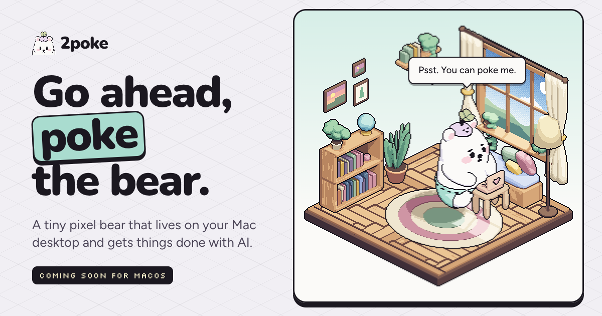

# 2poke



2poke is a tiny pixel bear that lives on your Mac desktop. It sits on the edges of your windows,
reacts when you poke it, and gets things done for you with AI. It asks before it does anything
risky.

The project's working name is **desk-buddy**. You'll see it in this repository's name, the crate
names, the settings folder (`~/.desk-buddy`) and the docs.

> **Status: early, in active development.** It runs on macOS, built from source (tested on macOS 15,
> Apple Silicon). There are no release builds yet.

## What it does

- **Lives on your desktop.** The bear floats above your windows in its own transparent panel, and
  clicks pass through everywhere except the bear itself. Drag it anywhere, or drop it on a window's
  top edge and it sits there with its legs dangling.
- **Feels alive.** Every move is animated in 8 directions: fidgets, naps, tea, knitting, fishing,
  building a snowman, rare surprises and seasonal hats. It notices music playing, the time of day,
  your cursor, being dragged and you stepping away.
- **Talks and works.** Click the bear and type. The answer streams into a speech bubble. Behind it
  is an agent with shell-first tools for files, the web, a browser window and your music app.
- **Asks first.** Every tool call goes through an approval policy: ask every time, ask only when
  unsure, or full access, with allow and deny rules in Claude Code's format. Once the chat has read
  a web page, the bear asks again before it acts.
- **Uses your AI account.** Sign in with Anthropic, OpenAI / ChatGPT, GitHub Copilot, OpenRouter,
  Google Gemini, xAI or Mistral. Keys and tokens stay in the macOS keychain and in the app's
  memory. The agent process never sees them.
- **Has a room.** Pick one of five floors. Small furniture scenes appear around the bear while it
  reads, naps or makes tea.
- **Comes with a studio.** Make your own mascot from an Aseprite file, edit its clips and
  behaviors, check it with a linter and a long-run audit, and put it on your desktop.

## Get started

You need:

- macOS
- [Rust](https://rustup.rs) (stable) and [Bun](https://bun.sh) 1.3 or newer
- about 3 GB of free disk space for the first build

```sh
git clone https://github.com/be4rz/desk-buddy.git
cd desk-buddy
export CARGO_TARGET_DIR="$PWD/target"

# The agent: one binary at agent/dist/buddy-agent
(cd agent && bun install && bun run build)

# The app and the `buddy` command the agent uses
cargo build -p buddy-app -p host --bin buddy
cargo run -p buddy-app
```

The bear appears on your desktop, with an icon in the menu bar. Open **Accounts…** from that icon to
connect an AI account, then click the bear and type. Quit from the same menu.

Your settings live in `~/.desk-buddy/`. To try something without touching them, start the app with
`BUDDY_HOME=$(mktemp -d) cargo run -p buddy-app`.

## How it fits together

- **Rust owns the app**: the windows and the bear's panel, its brain and renderer, the senses,
  widgets, approvals, the keychain, and a loopback host API with the `buddy` command line.
- **The agent loop is a TypeScript sidecar** built on
  [pi-durable](https://github.com/earendil-works/pi) and compiled with Bun into a single binary. It
  talks to Rust over JSON lines on stdin and stdout. Every tool call goes to Rust's policy before it
  runs.
- **The bear is data.** A mascot pack (`mascots/bear/pack.json`) lists its clips, behaviors, idle
  life and reactions. The brain picks what to play, and the renderer composites the frames on the
  CPU. Any mascot that follows the package standard plugs in the same way.

| Path | What it is |
| --- | --- |
| `crates/buddy-app` | The menu-bar app: tray, the bear's panel, speech bubble, sign-in, widgets, studio window |
| `crates/mascot-core` | The brain: pack loader, intents, idle scheduler, reactions, event replay |
| `crates/mascot-render` | Headless compositor from pack art to a pixel canvas |
| `crates/mascot-protocol` | The events the agent sends to the brain |
| `crates/bridge` | Starts and talks to the agent sidecar, and holds credentials |
| `crates/policy` | Approval modes and allow/deny rules for tool calls |
| `crates/host` | The loopback host API and the `buddy` command line |
| `crates/widgets` | Widget windows: the music player and the browser |
| `crates/studio` | Headless studio tools: render, sheets, GIFs, lint, audit |
| `agent/` | The TypeScript agent sidecar |
| `mascots/` | Mascot packs and the package standard |
| `rooms/` | Room packs: floors and scenes |
| `experiments/mascot/bear3d/` | The Blender pipeline that renders every sprite |
| `site/` | The landing page |
| `docs/` | The design plan, the desktop test checklist and spike notes |

## The art

All art is modeled and animated in Blender, rendered headless from an isometric camera in 8
directions at 12 frames per second, then snapped to a fixed palette with a 1-pixel ink outline.
Nothing is drawn in code. Every stage has a verifier that checks the palette, transparency,
outlines and the frames where one clip hands off to the next, pixel for pixel.

To re-render, you need [Blender](https://www.blender.org) 5.0 and Python 3 with Pillow and NumPy.
Start with `sh run.sh` in `experiments/mascot/bear3d/`. The stages, their order and their checks are
in [AGENTS.md](AGENTS.md#mascot-pipeline-experimentsmascotbear3d). To browse every sprite sheet:

```sh
python3 -m http.server 8771 --directory experiments/mascot/out
# open http://127.0.0.1:8771/bear3d/sheets.html
```

## Make your own mascot

Open **Studio…** from the menu-bar icon, or run `cargo run -p buddy-app -- --studio`. You can start
from an `.aseprite` file or a copy of the bear, edit the details, clips, behaviors and idle pool, and
put the result on your desktop. The package format is described in
[mascots/README.md](mascots/README.md), and `buddy studio lint` and `buddy studio audit` check a
pack from the command line.

## Development

```sh
export CARGO_TARGET_DIR="$PWD/target"
cargo test --workspace
(cd agent && bun run typecheck && bun test)
(cd experiments/mascot/bear3d && python3 verify_b.py)
```

- `BUDDY_EVENTS=crates/buddy-app/tests/fixtures/events.jsonl cargo run -p buddy-app` replays agent
  events without a model.
- `BUDDY_STATS=1` prints frame rate and CPU use every 10 seconds, and `BUDDY_DUMP=<dir>` saves the
  bear's canvas as PNGs.
- [AGENTS.md](AGENTS.md) (also `CLAUDE.md`) is the working guide for people and coding agents. It
  covers the ground rules, every environment variable and the art pipeline.
- [docs/designs/desk-buddy-plan.md](docs/designs/desk-buddy-plan.md) is the design: the runtime
  split, the mascot contract, the settled decisions (D1 to D16) and the roadmap.
- [docs/handover.md](docs/handover.md) lists the checks that need a real desktop, keychain or
  account.

## Contributing

Issues and pull requests are welcome. For anything large, open an issue first, and read the settled
decisions in the design plan before proposing to change one. A few rules hold everywhere:

- Art comes from the pipeline. Sprites are never drawn in code.
- The bear stays cute and toy-like.
- Mascots are original characters.
- Never commit keys, tokens or `.env` files.

Code you contribute is licensed under MIT, and art under CC BY-NC 4.0, the same as the rest of the
repository.

To report a security problem, use **Report a vulnerability** on the repository's Security tab
rather than a public issue.

## License

- **Code**: MIT, see [LICENSE](LICENSE).
- **The bear and all art**: CC BY-NC 4.0, see [ARTWORK.md](ARTWORK.md). You may use and remix it
  for non-commercial purposes with credit.
- **Fonts** in `site/assets/fonts/`: SIL Open Font License 1.1.
- **The name "2poke"** and its logo are not licensed for reuse.
